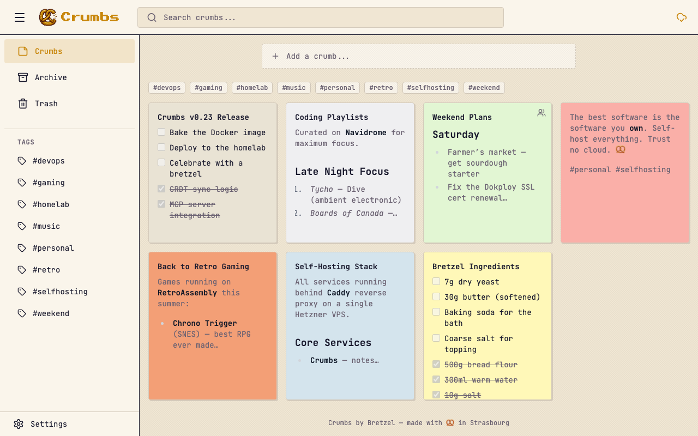

[](https://github.com/bretzel-app/crumbs/actions/workflows/ci.yml)
[](LICENSE)
[](https://github.com/bretzel-app/crumbs/releases)
[](https://github.com/bretzel-app/crumbs/pkgs/container/crumbs)

<p align="center">
  
</p>

# Crumbs by Bretzel

A self-hostable, offline-first note-taking app that respects your privacy. Part of the [Bretzel](https://bretzel.app) app universe.

<p align="center">
  
</p>

## Install

### Docker (Recommended)

```bash
mkdir crumbs && cd crumbs
curl -fsSLO https://raw.githubusercontent.com/bretzel-app/crumbs/main/docker-compose.yml
docker compose up -d
```

Open http://localhost:3000 and create your admin account. The first visitor becomes the admin, so do this before exposing the port.

To use it from other devices you need HTTPS and a matching `ORIGIN`. Plain `http://<server-ip>:3000` won't keep you signed in. [docs/DEPLOYMENT.md](docs/DEPLOYMENT.md) covers reverse proxies, backups, updates and a production checklist.

#### With SSO (optional)

```yaml
# docker-compose.yml
services:
  crumbs:
    image: ghcr.io/bretzel-app/crumbs:latest
    ports:
      - "3000:3000"
    volumes:
      - crumbs-data:/data
    environment:
      - ORIGIN=https://notes.example.com
      - AUTH_OIDC_ISSUER=https://authentik.example.com/application/o/crumbs/
      - AUTH_OIDC_CLIENT_ID=your-client-id
      - AUTH_OIDC_CLIENT_SECRET=your-client-secret
      - AUTH_OIDC_DISPLAY_NAME=Authentik
    restart: unless-stopped

volumes:
  crumbs-data:
```

Google and GitHub OAuth are also supported. See [docs/AUTH.md](docs/AUTH.md) for all providers and setup guides.

#### With Email Notifications (optional)

Add SMTP settings to enable email notifications (share alerts, welcome emails, security alerts):

```yaml
environment:
  - SMTP_HOST=smtp.example.com
  - SMTP_PORT=587
  - SMTP_USER=your-username
  - SMTP_PASS=your-password
  - SMTP_FROM=Crumbs <noreply@example.com>
```

Auto-enabled when `SMTP_HOST` is set. Users can opt out in Settings > Preferences. See [docs/DEPLOYMENT.md](docs/DEPLOYMENT.md#email-notifications-optional) for details.

### Manual (Node.js 22)

```bash
git clone https://github.com/bretzel-app/crumbs.git && cd crumbs
pnpm install --frozen-lockfile
pnpm build
DATABASE_URL=./data/crumbs.db ORIGIN=http://localhost:3000 BODY_SIZE_LIMIT=12M node build
```

Use Node.js 22 (see `.nvmrc`). See [docs/DEPLOYMENT.md](docs/DEPLOYMENT.md#manual-deployment-nodejs) for a production setup with systemd.

### Development

```bash
pnpm install
pnpm dev
```

Run `make help` to see all available commands, or use pnpm directly:

```bash
pnpm test          # Unit + E2E tests
pnpm check         # Type checking
pnpm build         # Production build
```

## Features

- Rich notes with Markdown, checklists, image attachments, and 12 color themes
- Organize with #tags, pinning, archive, and trash
- Full-text search across titles, content, and tags
- Note version history — browse and restore previous versions
- Share notes with other users on the same instance
- Email notifications for shares, security alerts, and account events (optional SMTP)
- PWA — installable, works offline via IndexedDB + LWW CRDT sync
- MCP server — let AI assistants (Claude Code, etc.) manage your notes
- Multi-user auth (Argon2) with optional OAuth/SSO (Google, GitHub, OIDC)
- Docker deployment with a single command

See [docs/FEATURES.md](docs/FEATURES.md) for detailed feature documentation.

## Tech Stack

| Layer | Technology |
|-------|-----------|
| Framework | SvelteKit 2 (Svelte 5 runes) |
| Language | TypeScript (strict) |
| UI | Tailwind CSS 4 |
| Database | SQLite (better-sqlite3) + Drizzle ORM |
| Client DB | IndexedDB (idb) |
| Sync | LWW CRDTs |
| Auth | Argon2 + session cookies |
| Testing | Vitest + Playwright |
| Container | Docker (multi-stage) |
| CI/CD | GitHub Actions |

## Documentation

| Document | Description |
|----------|-------------|
| [Features](docs/FEATURES.md) | Detailed feature list and behavior |
| [Architecture](docs/ARCHITECTURE.md) | Local-first sync design, tech rationale, DB schema |
| [Auth](docs/AUTH.md) | Password auth, OAuth/SSO setup (Authentik, Keycloak, etc.) |
| [Deployment](docs/DEPLOYMENT.md) | Docker, Node.js, reverse proxy, backups, env vars |
| [API](docs/API.md) | REST API reference (auto-generated) |
| [Contributing](CONTRIBUTING.md) | How to contribute |
| [Security](SECURITY.md) | Vulnerability reporting policy |
| [Changelog](CHANGELOG.md) | Release history |

## CI/CD

- **CI** — lint, type check, unit tests, E2E tests, Docker build on every push/PR
- **Release** — builds and pushes a multi-arch (`amd64`, `arm64`) image to `ghcr.io/bretzel-app/crumbs` on `v*` tags, authenticated with the workflow's `GITHUB_TOKEN` (no extra secrets needed)

## License

[MIT](LICENSE)
